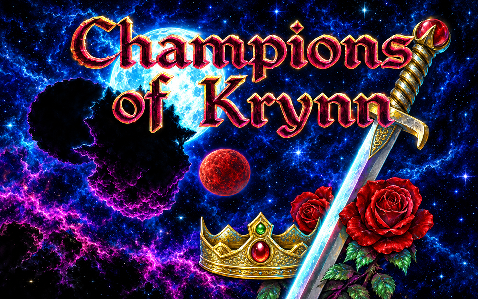
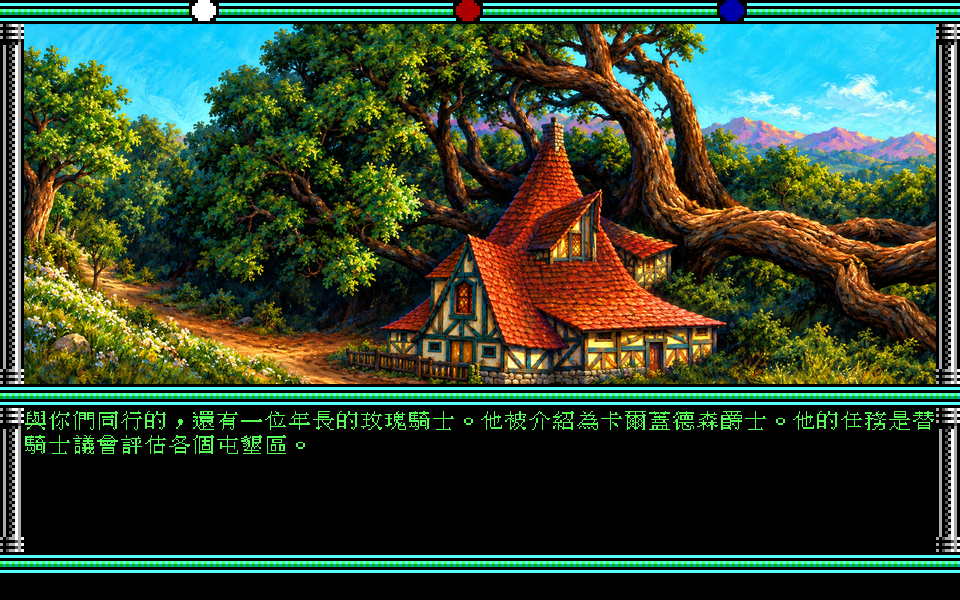
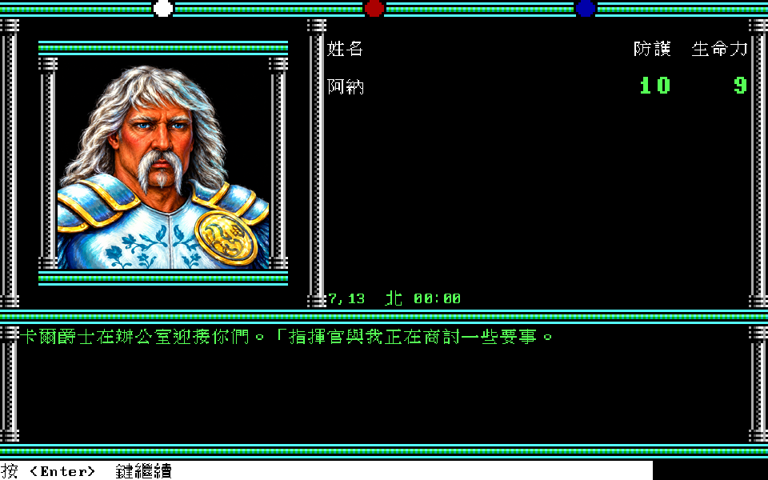
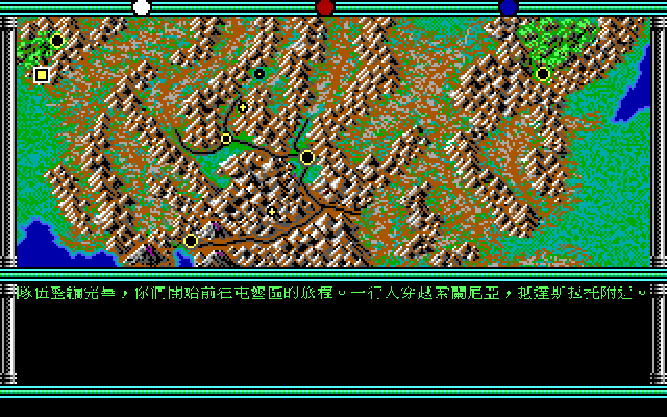
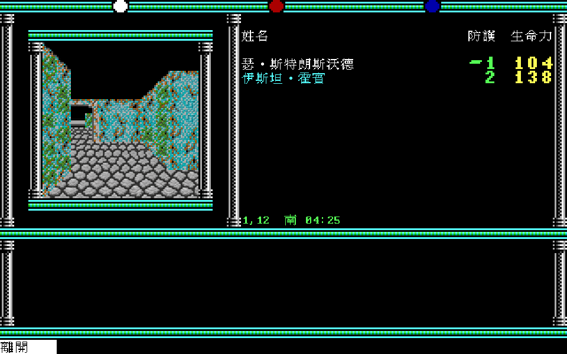
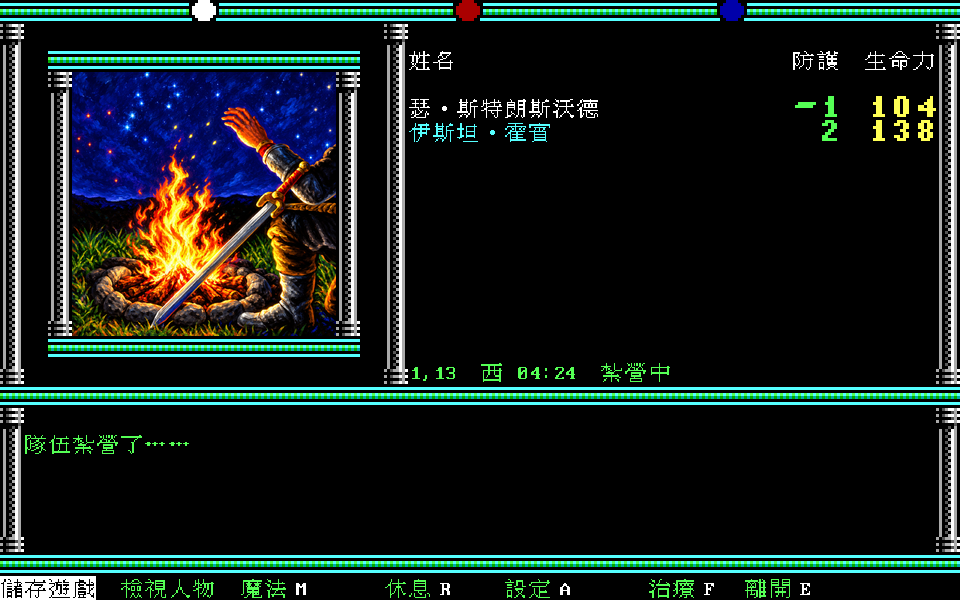
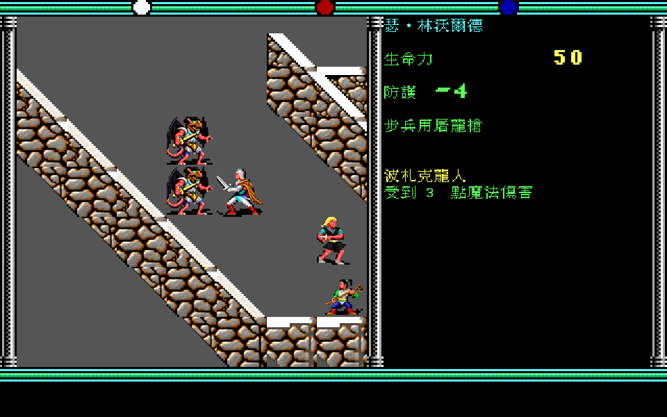
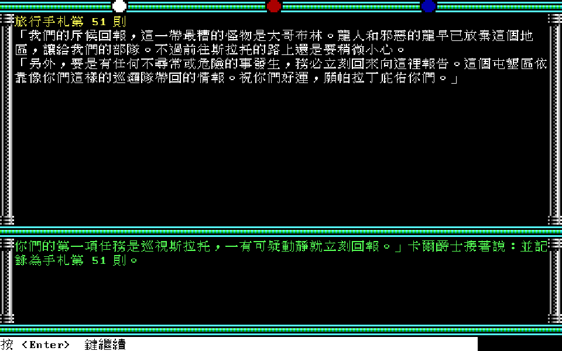
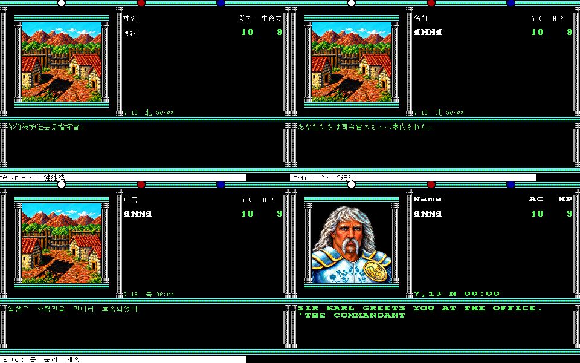

# 克萊恩英豪（Champions of Krynn）繁體中文化

以 [dosgolem](https://github.com/wicanr2/dosgolem) 執行 SSI 1990 年 DOS 版《Champions of Krynn》v1.2，
在執行期攔截原版輸出並覆繪繁體中文。原版遊戲、規則與存檔保持原樣，需自備原版。

現況見 [CONTEXT.md](CONTEXT.md)，工作項目見
[GitHub Issues](https://github.com/wicanr2/champions-of-krynn-cht/issues)，協作規則見 [AGENTS.md](AGENTS.md)。

## 成果

| 項目 | 內容 |
|---|---|
| 中文化 | 遊戲內文字全部覆繪繁體中文：選單、劇情視窗、底列選單、組句訊息，3,173 句；玩家自建角色名自動音譯 |
| 手札與傳聞 | 88 則旅行手札與 57 則酒店傳聞，劇情提到「參見手札第 N 則」時在遊戲內直接開啟 |
| 手冊查驗題 | 49 題答案表，問句後直接顯示答案 |
| 攻略與地圖 | 《軟體世界》第 16–18 期攻略 19 章（F6）；15 張地圖疊層與 157 個攻略點（F7） |
| HD 重繪 | 1,841 項：標題、場景圖、人物頭像、戰鬥圖塊、3D 牆面與天空，在 3 倍畫面顯示 |
| 配樂 | 以原版標題曲動機新編 12 首 OPL2 配樂，依地圖與戰鬥切換；原版 AdLib 音效照常 |
| 多語系 | 繁中、简中、日本語、한국어、English，第一次啟動依系統語言，F8 切換 |
| 作弊 | 我方無敵（F1，預設關）：HP 不減少，不會昏迷、中毒、麻痺、睡眠、倒戈 |
| 發行 | Linux AppImage、Windows、macOS 三平台包，各有原版與原版加 HD 兩種，玩家自備原版 |

原版程式不做任何修改，所有中文、HD 與配樂都在執行時疊加；切換列或 F12 可隨時切回英文原版對照。

## 故事背景

本作的舞台是《龍槍》系列小說與 AD&D 共用的世界克萊恩（Krynn），也是 SSI 克萊恩三部曲的第一部，續作是《幽靈騎士》（Death Knights of Krynn）。
龍槍戰爭剛結束，黑暗之后塔克西絲的龍軍在奈拉卡潰敗，可是龍人殘軍、邪惡牧師與各地的怪物並沒有消失。
索蘭尼克騎士在邊境設下幾座屯墾區，招募冒險者守住戰後殘破的土地。

你們的隊伍來到第一屯墾區報到。卡爾爵士熱情接待，派下第一項任務：巡視東北方的斯拉托，有任何可疑的動靜立刻回報。
一出屯墾區，隊伍就撞見龍人屠殺商隊，倖存的龍人搶走一本書逃走。回到屯墾區時，指揮官已被冒名頂替，屍體現出西維克龍人的原形。
在斯拉托，隊伍聽見斷斷續續的回聲：「麥坦尼的計畫……神殿中的蛋……死亡騎士……」。麥坦尼這個名字從此一再出現，連科南都被他和新造出的大批龍人占領（手札）。
隊伍要走遍蓋加斯、傑勒克、奈拉卡與桑克申，追查他的陰謀。

遊戲中的長篇劇情不印在畫面上，而是以「參見手札第 N 則」指向隨盒附的《冒險者手札》。本中文化把 88 則手札與 57 則酒店傳聞譯成中文，引用時直接在遊戲內開啟面板，不必另翻手冊。

出處：遊戲開場劇情與手札（`text/ecl-text.zh-TW.tsv`、`text/journal.zh-TW.tsv`）、《軟體世界》第 16–18 期攻略（白怒火、南帝），內容經改寫。

## 畫面

以下是 dosgolem 執行原版並覆繪中文後的 2 倍畫面（2026-10-19，收據 [docs/re/007](docs/re/007-g5-receipt.md)）。

| | |
|---|---|
|  |  |
| 建立隊伍主選單 | 3D 城市、隊伍欄與隊員名音譯 |
|  |  |
| 手冊查驗題，問句後顯示答案（F9 切換） | 旅行手札自動彈出（F5 可翻閱） |
|  |  |
| 屯墾區底列選單 | 戰鬥選單與角色欄 |
|  |  |
| 遊戲內攻略（F6，軟體世界雜誌） | 地圖疊層與攻略點（F7） |

### 3 倍與 HD 重繪

3 倍畫面（F2 切換）。標題、場景、頭像、營地、3D 牆面與戰鬥是 HD 重繪；大地圖與手札面板是原版圖與中文字的 3 倍放大。

| | |
|---|---|
|  |  |
| 主標題，HD 重繪 | 開場劇情，最後家園旅店 HD 重繪 |
|  |  |
| 卡爾爵士頭像，HD 重繪 | 大地圖與劇情（原版圖 3 倍） |
|  |  |
| 斯拉托 3D 牆面，HD 重繪 | 紮營畫面，HD 重繪 |
|  |  |
| 戰鬥圖塊，HD 重繪 | 旅行手札第 51 則（3 倍） |

同一段對話的简中、日文、韓文、英文：



## 遊玩

```sh
tools/play.sh   # Docker＋主機 X11；F2 切換 2 倍／3 倍，F12 中文／原版
```

需先依 [docs/re/001](docs/re/001-input-baseline.md) 準備原版，依 `tools/font-dev.sh` 建立字型。
原版附的 `KRYNN.CFG` 音效選 Roland，程式啟動時改成 AdLib；原版的預建隊伍會放進存檔目錄，主選單 LOAD SAVED GAME 選 A 即可載入。

## 語言

繁體中文為人工翻譯。簡體中文由繁體中文以 OpenCC 轉換。日文、韓文為機器翻譯，未經母語者校對。英文版保留原文，以 Courier Prime 重繪，並可在遊戲內閱讀英文手札。第一次啟動依系統語言選擇，遊戲中按 F8 切換，規格見 [docs/spec/015](docs/spec/015-multilingual.md)。

## 授權

本專案自有的程式與文件採 [RRSAL-1.0](LICENSE)（source-available，非商業免費、商業另洽）。
授權不涵蓋原版遊戲素材，使用者須自備合法取得的原版。手札譯自 SSI 英文版 Adventurer's Journal，
攻略取自《軟體世界》雜誌第 16–18 期，著作權屬原權利人。
